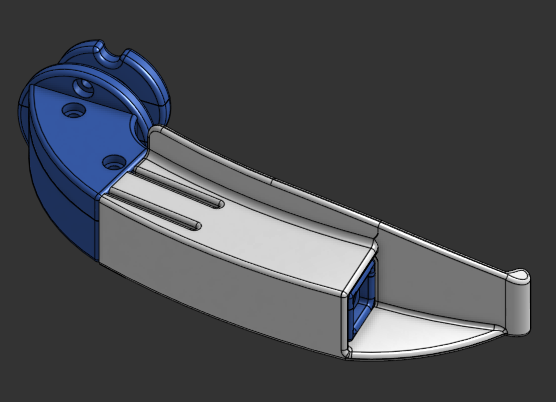
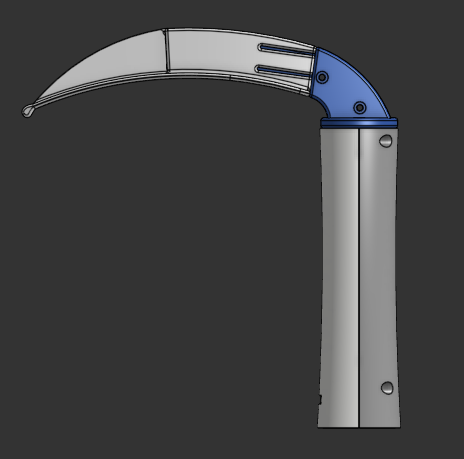
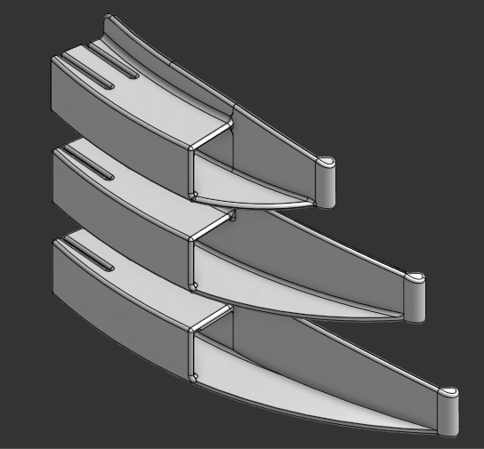

# Video Laryngoscope

**Curved Macintosh-style single-use video laryngoscope blades in sizes 2 to 4, with an independent, reusable camera holder, designed to mate with a client-supplied handle**

<table>
<tr>
<td width="50%" valign="top">

</td>
<td width="50%" valign="top">

</td>
</tr>
<tr>
<td width="50%" valign="middle">

</td>
<td width="50%" valign="top">

</td>
</tr>
<tr>
<td width="50%" valign="middle">

</td>
</tr>
</table>

- **Role:** Sole CAD designer for the blade and camera holder
- **Software:** Onshape
- **Context:** Freelance contract
- **Status:** Delivered CAD models.

---
## Overview

This repository documents the mechanical design of a single-use video laryngoscope blade family and the reusable camera holder that carries the camera. The client supplied the handle and the camera. I designed the blades and the holder to fit them.

The system has three parts:

| Part | Reuse | Designed here |
|---|---|---|
| Handle | Reusable | No, supplied by the client |
| Camera holder | Reusable | Yes |
| Blade (Mac 2, 3, 4) | Single use | Yes |

The handle encloses a section of the camera holder and forms a semi-permanent joint with it. The blades are the replaceable part. A snap fit joint on the far side of the blade clicks into the grooves provided in the camera holder.

---
## Design requirements

- Curved Macintosh-style blade geometry in sizes 2, 3 and 4
- Single-use blades with a reusable camera holder
- One camera holder that works with every blade size
- Fit to a client-specified handle interface
- Suitable for injection molding in polycarbonate (PC)

---
## Design details

### Blade family

The blades share one holder section and differ in size.

| Size | Blade length | Blade height | Tip thickness  |
|---|---|---|---|
| Mac 2 | 92 mm  | 26 mm | 3.5 mm |
| Mac 3 | 115 mm | 26 mm | 3.5 mm |
| Mac 4 | 132 mm | 26 mm | 3.5 mm |

Blade length changes across the sizes while the camera holder section stays the same, so any blade fits the holder. The curvature is adjusted to fit the length constraint.

### Camera holder

The holder is made in two parts to make assembly easier. The parts are joined by two M2 bolts near the handle mount. The camera snaps into cylindrical grooves in the front of the holder.

### Camera line of sight

The blade tip is angled 1.5 degrees away from the camera axis to reduce blade occlusion in the image. This angle was chosen based on the camera's FOV and the length of the blades in front of the camera.

---
## Manufacturing

- **Prototypes:** 3D printed in PETG on a Bambu A1.
- **Production intent:** Injection molding in polycarbonate (PC).
- **Wall thickness:** A uniform 2 mm, chosen for molding. Even walls reduce sink marks and warping.
- **Material choice:** PC was chosen for its transparency and the surface finish which can repel germs for short durations.

---
## Repository contents

[Adjust to match the repo.]

    images/        Renders and photos used in this README
    3D-files/      blades and cam holder parts

---
## Confidentiality and use

Client name and product details are withheld. The handle interface geometry is not included. This work is shared with the client's permission.

This is a design record only. It is not a certified medical device, and no regulatory approval is claimed.